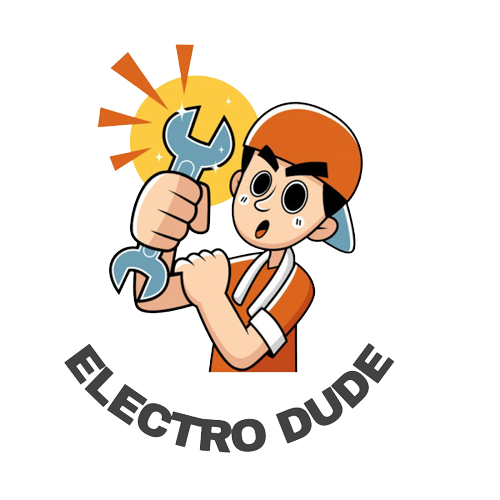

  

# ELECTRO DUDE

Official home of **AURA**, the ELECTRO DUDE desk companion.

Paste the bio below into an Origin or GitHub profile. The firmware repository is the official ELECTRO DUDE AURA release.

## Bio

ELECTRO DUDE builds AURA, a desk companion you can flash and set up yourself. Official firmware: AURA v3.1.6.

## Links

- Firmware: this AURA repository (open `AURA_v3.ino`, or download `releases/AURA_v3_subscriber.zip`)
- YouTube: https://www.youtube.com/c/ElectroDude
- Instagram: https://www.instagram.com/electro__dude/
- Hackster: https://www.hackster.io/Electrodude/
- Facebook: https://www.facebook.com/Electroodude

## One-line bio

ELECTRO DUDE · AURA v3.1.6 desk companion · official firmware in this repo.
