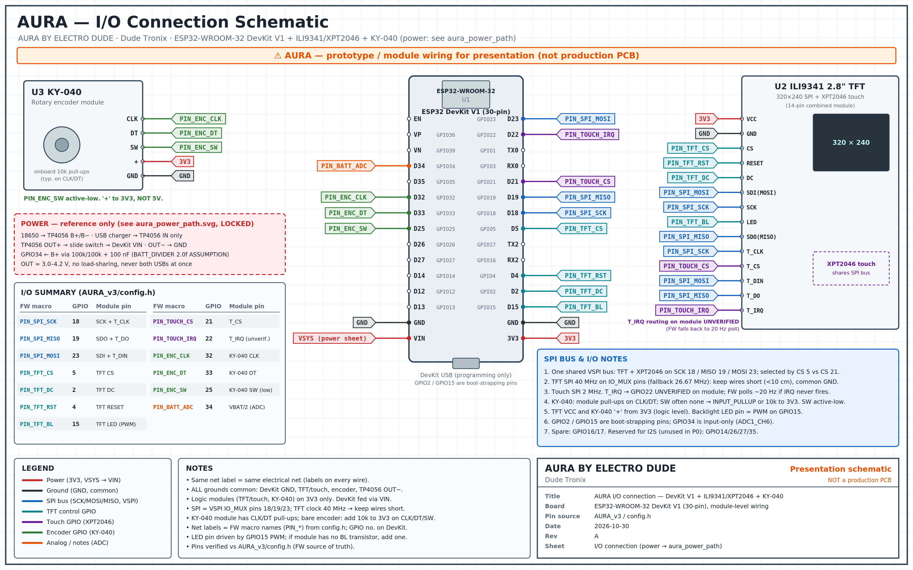
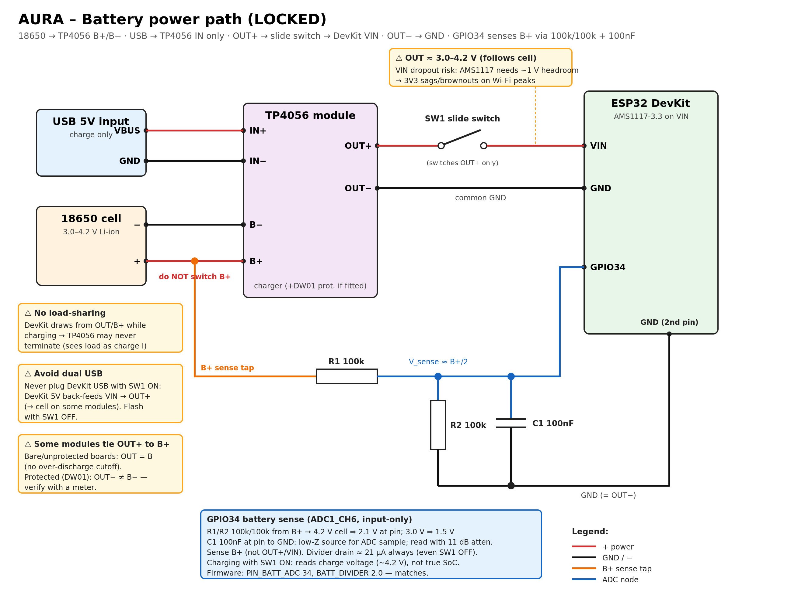

# Schematic: AURA v3.1.6

Electrical drawings for the AURA desk buddy by ELECTRO DUDE. These files hold no Wi-Fi passwords or API keys.

| File | What it shows |
|---|---|
| [`AURA_connection_schematic.png`](AURA_connection_schematic.png) / [`.svg`](AURA_connection_schematic.svg) | Full I/O wiring: ESP32-WROOM-32, ILI9341 TFT, XPT2046 touch, KY-040 rotary encoder, battery sense |
| [`aura_power_path.png`](aura_power_path.png) / [`.svg`](aura_power_path.svg) | Battery power path: 18650 → TP4056 USB-C charger/protection → switch → ESP32 |
| [`aura_power_path.md`](aura_power_path.md) | Power path written out |
| [`AURA_power_path_locked.md`](AURA_power_path_locked.md) | The fixed (locked) power-path decisions |
| [`AURA_pin_net_table.md`](AURA_pin_net_table.md) | Pin-by-pin net list (GPIO → module pin) |

The display and touch controller share one SPI bus and use separate chip-select pins. All logic runs at 3.3 V.
The pin map is also in the main [README](../../README.md#-pin-map).

